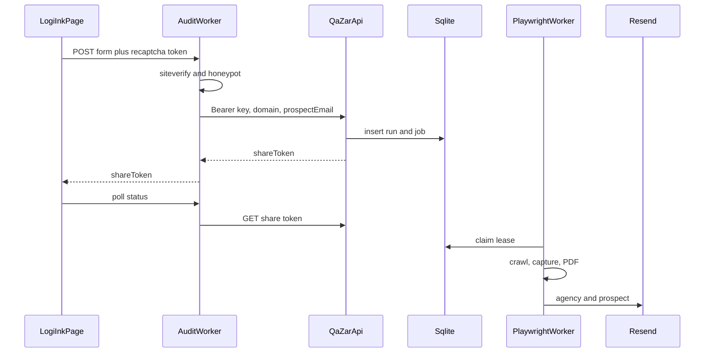

# Phase 4 — Integration and hardening

Execution plan for turning qaZAR from a single-operator tool into the backend behind the Logi-Ink contact form. Prose uses UK spelling. Code identifiers stay as they are (`artifact`, `ownerId`, `evaluate`).

This file is the index. The tasks live in the pillar docs (each under the 200-line cap):

- [Infrastructure and security](docs/phase-4/01-hardening.md)
- [Durable queue and concurrency](docs/phase-4/02-queue.md)
- [PDF and email](docs/phase-4/03-pdf-email.md)
- [Logi-Ink seam](docs/phase-4/04-logi-ink.md)

No application code is specified as done here. Implement the pillars in order: a public form must not enqueue work until keys, share tokens, and the worker exist.

## Decisions

- **Queue:** `node:sqlite` (`DatabaseSync`) in-process. Bump `engines.node` from `>=20` to `>=22`. No Redis, no BullMQ, no `better-sqlite3`. Comparison: [02-queue.md](docs/phase-4/02-queue.md).
- **Mail:** HTTPS to Resend via `fetch`. No `nodemailer`. Postmark is a one-module swap. Comparison: [03-pdf-email.md](docs/phase-4/03-pdf-email.md).
- **Form seam:** a Cloudflare Worker in the Logi-Ink repo. Logi-Ink stays static HTML, vanilla JS, and Vite. The browser never sees `QAZAR_API_KEY`.
- **New dependency:** `express-rate-limit` only. PDF uses the Playwright Chromium already in `server/engine/capturePage.js`.
- **Out of scope:** Stripe, LemonSqueezy, quotas beyond the public page cap, and S3/R2. Those stay in Phase 3 of `TODOS.md`.

## Flow

1. The page posts the enquiry to the Worker. `#website` stays the honeypot. The audit target is the new `#auditUrl` field.
2. The Worker checks the honeypot and reCAPTCHA, then calls `POST /api/runs` with a bearer key. `ownerId` comes from the key, never the JSON body.
3. The API inserts a run (`crypto.randomUUID()`) and a job, and returns `shareToken` to the Worker. The browser receives only that token.
4. The Playwright worker claims the job with a lease. A restart requeues an expired lease. It does not mark the job failed on boot.
5. After captures, the worker writes `report.pdf`, then mails `AGENCY_INBOX` and `prospectEmail`. Mail failure does not recrawl.
6. The page polls the Worker every 2 seconds. It does not open an `EventSource` to qaZAR.

## Verification

- qaZAR: `npm test` (auth, queue, host gate) and `npm run build:web` after `web/api.js` drops gist discovery.
- Logi-Ink: existing contact tests still pass with the Worker mocked.
- Manual: submit a public `https` URL from `contact.html`. The network panel shows only the Worker origin. The prospect and `AGENCY_INBOX` each get one PDF. `GET /api/runs` without a key is 401.

## Current holes this phase closes

- The tunnel and gist discovery stay. GitHub Pages cannot send a cross-site cookie, so the console keeps using the tunnel without a bundled key. Partner calls send a bearer key.
- `JsonDatabaseAdapter.create` builds ids from a timestamp plus `crypto.randomBytes(3)`. Routes never pass `ownerId`.
- `cors()` is open and `express.static` serves `data/runs`.
- `server/queue/jobQueue.js` chains `processRun` on `Promise.resolve()`. `loadAll()` fails in-flight runs on restart.
- `loadRobots()` drops `crawlDelay` even though `parseRobotsTxt()` returns it.
- `generateExecutiveReport()` is HTML only. `?email=` only rewrites a `mailto:` link.
