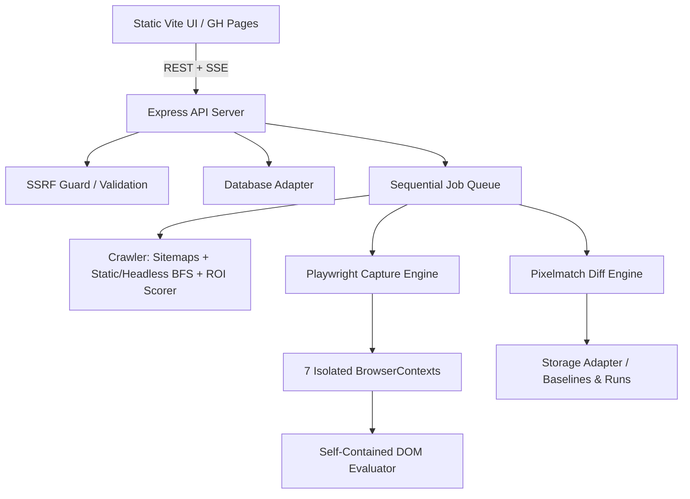

# qaZAR Architecture

qaZAR is a multi-viewport UI/UX QA and visual regression testing suite designed for automated quality assurance and future-proof multi-tenant monetisation.

## Core Subsystems

### 1. Viewport Isolation Engine (`server/engine/`)
- Emulates exactly 7 immutable viewports (ultrawide, fhd, macbook, desktop, laptop, tablet, mobile).
- Spawns a **fresh BrowserContext** for every single page x viewport capture.
- Freezes CSS animations, transitions, and carets. A default audit does not replace `Date` or `Math.random`. `deterministic: true` does, and the report says so.

### 2. Self-Contained DOM Evaluator (`server/heuristics/evaluate.js`)
- Injected directly into live pages via `page.evaluate()`.
- Must remain 100% self-contained: no external imports, no outer-scope closures.
- Evaluates overflow, WCAG 2.2 target size (24px with exceptions; 48px is advisory), typography, WCAG AA contrast, media bleed, possible overlaps, and navigation collapse.

### 3. Smart Crawler & ROI Scorer (`server/crawler/`)
- Ingests sitemaps (standard XML and sitemap-indexes) or executes BFS.
- **Top ROI Candidate Selection**: Ranks discovered URLs using path depth, commercial/UX keyword weights (pricing, signup, cart, app), and structural template diversity penalties.
- **Headless JS Crawl Fallback**: Discovers dynamically mounted routes on Single Page Applications (SPAs).

### 4. Storage & Persistence Abstraction (`server/storage/`)
- `storageAdapter.js`: Manages screenshots, diff overlays, and baselines. File-backed default with zero-churn S3/Cloudflare R2 readiness.
- `databaseAdapter.js`: Manages run lifecycle and state with multi-tenant `ownerId` support and SSE pub-sub broadcasting.
